<div align="center">



<br /><br />

<a href="https://repo.nvc.ac.in/home"></a>


</div>

## About

Knowledge Hub is an institutional repository initiative of the Central Library, Nabadwip Vidyasagar College. It preserves and shares the college's scholarly and institutional output in open access.

This repository holds the **DSpace 10 customisation** behind it: a custom Angular theme, install and deploy scripts, and a faculty publication harvester.

## DSpace 10 customisation

### 1. Knowledge Hub theme (`dspace-theme/knowledge-hub/`)

A full theme for the DSpace 10 Angular UI, built on the stock `custom` theme.

| Component | What it adds |
|---|---|
| `header/`, `header-nav-wrapper/`, `footer/` | College branding, a communities drop-down menu and a new footer |
| `home-page/` | Landing page with collection cards, live counts, 30-day download stats, recent items and copy-to-cite |
| `community-page/`, `collection-page/` | Redesigned community and collection pages |
| `entity-groups/.../person/` | **Faculty profile page**: photo or initials, research identifiers, publications and citation copy |
| `faculty-directory/` | Searchable, filterable directory of faculty profiles |
| `research-output/` | Faculty publications browser with filters and citations |
| `qp-archive/` | Old question paper archive with paging and quick PDF access |
| `styles/`, `assets/` | Theme colours, typography, `en.json5` labels, college emblem and favicons |

`dspace-theme/nvc/` is the earlier, lighter version of the theme (header, footer and home page only).

### 2. Theme scripts

| Script | Purpose |
|---|---|
| `dspace-theme/build-nvc-theme.sh` | Builds the theme into the DSpace Angular source. Backs up first and never touches the live site. |
| `dspace-theme/deploy-nvc-theme.sh` | Switches the live UI to the new build; `rollback` restores the previous one |
| `dspace-theme/nvc-stats.sh` | Hourly cron job: reads 30-day file downloads from the Solr statistics core (bots excluded) for the home page |

### 3. Server install (`dspace-install.sh`)

Resumable installer for **DSpace 10.1** on Ubuntu 24.04: PostgreSQL, Solr 9, the REST backend as a systemd service, and Node 22 with the Angular UI under PM2. The database password is generated randomly on the server and is never stored in this repository.

### 4. Publication harvester (`harvester/`)

| File | Purpose |
|---|---|
| `harvest.py` | Daily job. For each faculty profile it reads the public ORCID works list (plus Scopus / Web of Science if API keys are set), enriches each work by DOI from Crossref, OpenAlex and Unpaywall, removes duplicates, and publishes new items to Faculty Publications linked to their authors |
| `vidwan-pubs.py` | One-off import of publication lists from public Vidwan profiles |
| `install.sh` | Installs the harvester as a systemd timer |
| `harvester.example.json` | Sample configuration. Copy it to `harvester.json` and fill in your own values. |

## How to use

```bash
# 1. package the theme
cd dspace-theme
tar -czf nvc-theme.tgz knowledge-hub

# 2. on the DSpace server (as root): build, then deploy
bash build-nvc-theme.sh /tmp/nvc-theme.tgz
bash deploy-nvc-theme.sh            # or: bash deploy-nvc-theme.sh rollback
```

Placeholders such as `<DSPACE_IP>`, `<PROXY_IP>` and `admin@example.edu` mark values you need to replace with your own.

> **Note:** No passwords, API keys, account details or personal data are included in this repository.

## Built with

`DSpace 10.1` · `Angular` · `TypeScript` · `SCSS` · `PostgreSQL` · `Solr` · `Python` · `Bash`

## Maintainer

Built and maintained by **[Dr. Amalendu Das](https://github.com/amalendu-ls)**, Librarian, Nabadwip Vidyasagar College.
[Portfolio](https://sites.google.com/nvc.ac.in/amalendudas/home_1) · [ORCID](https://orcid.org/0000-0003-0799-0599)
